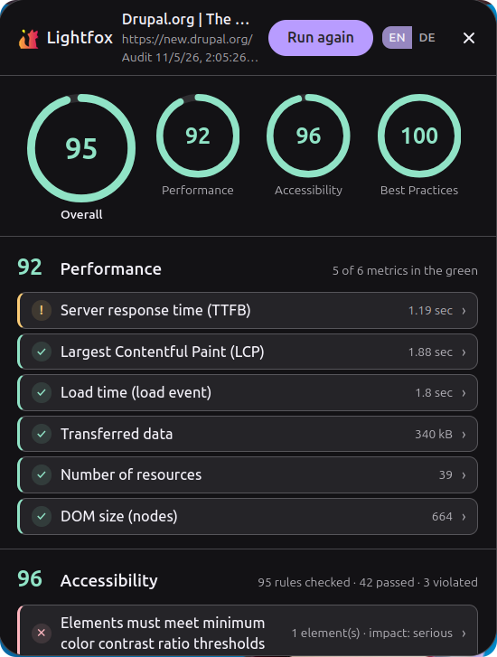
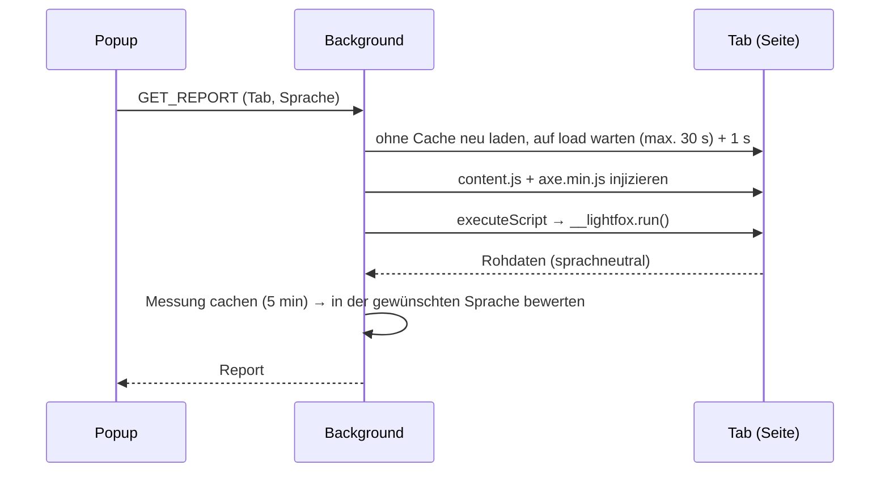
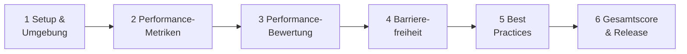

<p align="center">
  
</p>

<h1 align="center">Lightfox</h1>

<p align="center">
  <b>Lighthouse-artige Audits, direkt in Firefox.</b><br>
  Performance · Barrierefreiheit · Best Practices
</p>

<p align="center">
  
  
  
  
  <a href="LICENSE"></a>
</p>

<p align="center"><a href="README.md">English</a> · <b>Deutsch</b></p>

<p align="center">
  
  <br><sub>Audit der offiziellen <a href="https://new.drupal.org/drupal-cms">Drupal-CMS</a>-Seite (englische Ansicht)</sub>
</p>

Ein Klick auf den Toolbar-Button, und Lightfox **lädt die Seite ohne Cache neu**, misst diesen
frischen Ladevorgang in deinem echten Firefox und zeigt pro Kategorie einen Score (0–100) samt
aufklappbarer Befunde, ähnlich wie
[Google Lighthouse](https://developer.chrome.com/docs/lighthouse/overview), das
[nicht in Firefox läuft](https://github.com/GoogleChrome/lighthouse#lighthouse).
Oberfläche auf **Englisch und Deutsch** (EN/DE-Schalter im Popup, die Wahl wird gemerkt).

> **Early Alpha:** Der Kern funktioniert; Sonderfälle werden bewusst kaum behandelt. Erwarte
> Bugs und raue Kanten, und erwarte Änderungen. Siehe [TODO](#todo).

## Schnellstart

```bash
npm install
npm run build      # → dist/
npm start          # bauen + Firefox mit der Extension starten (web-ext)
```

Oder manuell laden: `about:debugging` → **Dieser Firefox** → **Temporäres Add-on laden** →
`dist/manifest.json`. Nach jedem Build dort auf **Neu laden** klicken.

| Befehl | Beschreibung |
| --- | --- |
| `npm run dev` | Build im Watch-Modus |
| `npm test` | Build + Content-Pipeline-Test + End-to-End-Simulation (jsdom) |
| `npm run check` | Typecheck + Tests + `web-ext lint` |
| `npm run icons` | PNG-Icons aus `public/icons/icon.svg` neu erzeugen |

## Aufbau



1. **Messen:** Das Content-Script sammelt nur Rohdaten: LCP über
   [web-vitals](https://github.com/GoogleChrome/web-vitals), Navigation/Resource Timing,
   Ergebnisse von [axe-core](https://github.com/dequelabs/axe-core) und 10 DOM-Checks. Es wird
   nur für eine Analyse injiziert, nie bei normalen Seitenaufrufen.
2. **Bewerten:** Der Background macht aus den Rohdaten Audits, Kategorie-Scores und Texte.
   Ein Sprachwechsel bewertet die gecachte Messung neu, ohne erneutes Neuladen.
3. **Anzeigen:** Das Popup zeigt Score-Ringe und aufklappbare Audits; JSON-Export inklusive.

```text
src/
  background/   Event-Page: Neuladen, Injektion, Cache · scoring.ts · audit-config.ts (Schwellwerte, Gewichte)
  content/      Content-Script: perf.ts · axe-runner.ts · best-practices.ts
  popup/        Popup-UI: main.ts (Anfragen, Sprache, Export) · render.ts (Vanilla-TS-DOM)
  shared/       types.ts · i18n.ts (EN/DE-Texte) · format.ts (Intl)
public/         manifest.json · _locales/ · popup.html/css · icons/
scripts/        build.mjs (esbuild → 3 IIFE-Bundles + axe.min.js) · build-icons.mjs
tests/          content-smoke.mjs · e2e-sim.mjs (echte dist/-Bundles in jsdom)
```

Regel: `content/` und `popup/` importieren nur aus `shared/`.

### Audits & Bewertung

| Kategorie | Was geprüft wird |
| --- | --- |
| **Performance** | TTFB (≤ 800 ms gut / ≥ 1,8 s schlecht) · LCP (2,5 s / 4 s) · Ladezeit (3 s / 8 s) · übertragene Bytes (2 MB / 5 MB) · Ressourcen (50 / 120) · DOM-Knoten (1.500 / 4.000) |
| **Barrierefreiheit** | axe-core-Regeln mit WCAG-2.0–2.2-A/AA- und `best-practice`-Tags; jede Verletzung mit Impact, Elementen, WCAG-Kriterien und Regel-Doku |
| **Best Practices** | HTTPS · Meta-Viewport · Standardmodus · Mixed Content · Charset · veraltetes HTML · `rel=noopener` · moderne Bildformate · Bild-Seitenverhältnisse · HTTP/2+ |

Metriken werden linear zwischen *gut* (1) und *schlecht* (0) bewertet. axe-Verletzungen zählen
nach Impact (critical 10 … minor 2) gegen bestandene Regeln (je 7). Gesamt = Performance 40 % ·
Barrierefreiheit 40 % · Best Practices 20 %; *n/a*-Audits und fehlende Kategorien zählen nicht.

## Lightfox vs. Google Lighthouse

| | Google Lighthouse | Lightfox |
| --- | --- | --- |
| Browser | Chrome / Chromium (DevTools Protocol) | Firefox (WebExtension, Manifest V3) |
| Aufruf | DevTools, PageSpeed Insights, CLI, Node-API, CI | Toolbar-Button |
| Modi | Navigation, Timespan, Snapshot | Navigation (Neuladen ohne Cache) |
| Bedingungen | Standardmäßig simuliertes Throttling (Mobil-CPU, langsames 4G) | Dein echter Firefox, CPU und Netz (kein Throttling) |
| Kategorien | Performance, Barrierefreiheit, Best Practices, SEO | Performance, Barrierefreiheit, Best Practices |
| Performance-Metriken | FCP, LCP, TBT, CLS, Speed Index | TTFB, LCP, Ladezeit, Bytes, Ressourcen, DOM-Größe |
| Performance-Bewertung | Log-Normal-Kurven auf Basis realer Daten | Linear zwischen *gut* und *schlecht* |
| Barrierefreiheits-Engine | axe-core | axe-core |
| Report | HTML, JSON, CSV | Popup, JSON-Export |
| Sprachen | Viele | Englisch, Deutsch |
| Status | Stabil | Early Alpha |

## Mitmachen

Lightfox ist eine **Early Alpha**: Alles ist noch im Fluss. Beiträge und Ideen sind ausdrücklich
erwünscht: Bug-Reports, Feature-Ideen, Pull Requests, Text- und Übersetzungsverbesserungen
(EN/DE), Messungen von deinen eigenen Seiten. Eröffne ein Issue oder einen Pull Request.

## TODO

- [ ] **CLS wieder aufnehmen:** für die Alpha entfernt: Firefox implementiert die
  [Layout Instability API](https://developer.mozilla.org/docs/Web/API/LayoutShift) nicht, der
  Wert war immer *n/a*. Wieder aufnehmen, sobald unterstützt, oder eine Näherung finden.
- [ ] **INP wieder aufnehmen:** für die Alpha entfernt: braucht eine Benutzer-Interaktion, die
  direkt nach dem Neuladen nie stattfindet. Optionen: weitermessen, bis das Popup erneut
  geöffnet wird, oder [Total Blocking Time](https://web.dev/articles/tbt) als Labor-Ersatz.

Betroffen beim Wiedereinbau: `PerfPayload` (`src/shared/types.ts`), `src/content/perf.ts`
(`onCLS`/`onINP`), `src/background/audit-config.ts` und `src/shared/i18n.ts`.

## Roadmap

Nächstes Ziel: jede Messung Schritt für Schritt prüfen und anpassen (Detailplan in den
Tutorial-Notizen, `20 Etappenplan Messlogik.md`).



| | Etappe | Schwerpunkt |
| --- | --- | --- |
| 1 | Setup & Messumgebung | Baseline-Reports, Testseiten; Neuladen, Ruhezeit, Injektions-Zeitpunkt |
| 2 | Performance-Metriken | TTFB & Ladezeit · LCP · Bytes, Ressourcen, DOM-Größe · **CLS & INP (TODO)** |
| 3 | Performance-Bewertung | Lineare vs. Log-Normal-Kurve, Gewichte, Mindestabdeckung, FCP |
| 4 | Barrierefreiheit | Auswahl der axe-Regeln, iframes; Impact-Gewichte & Score |
| 5 | Best Practices | Sicherheit (HTTPS, Mixed Content, noopener) · Dokument-Checks · Bilder & Protokoll |
| 6 | Gesamtscore & Release | Kategorie-Gewichte, Farben; Doku, Version `0.2.0` |

Etappe 1 zuerst; 2, 4 und 5 sind unabhängig; die Bewertung folgt ihren Messungen. Ein Abschnitt
= ein Commit mit [CHANGELOG](CHANGELOG.md)-Eintrag.

## Quellen

- **WebExtensions (MDN):** [tabs.reload](https://developer.mozilla.org/docs/Mozilla/Add-ons/WebExtensions/API/tabs/reload) ·
  [scripting.executeScript](https://developer.mozilla.org/docs/Mozilla/Add-ons/WebExtensions/API/scripting/executeScript) ·
  [Event-Pages](https://developer.mozilla.org/docs/Mozilla/Add-ons/WebExtensions/Background_scripts#event_pages) ·
  [Internationalisierung](https://developer.mozilla.org/docs/Mozilla/Add-ons/WebExtensions/Internationalization)
- **Performance:** [Core Web Vitals](https://web.dev/articles/vitals) ·
  [LCP](https://web.dev/articles/lcp) · [TTFB](https://web.dev/articles/ttfb) ·
  [DOM-Größe](https://web.dev/articles/dom-size) ·
  [Navigation Timing](https://developer.mozilla.org/docs/Web/API/PerformanceNavigationTiming) ·
  [Resource Timing](https://developer.mozilla.org/docs/Web/API/PerformanceResourceTiming) ·
  [web-vitals](https://github.com/GoogleChrome/web-vitals)
- **Barrierefreiheit:** [axe-core-API](https://github.com/dequelabs/axe-core/blob/develop/doc/API.md) ·
  [Regel-Übersicht](https://github.com/dequelabs/axe-core/blob/develop/doc/rule-descriptions.md) ·
  [WCAG 2.2](https://www.w3.org/TR/WCAG22/)
- **Best Practices:** [Sichere Kontexte](https://developer.mozilla.org/docs/Web/Security/Secure_Contexts) ·
  [Mixed Content](https://developer.mozilla.org/docs/Web/Security/Mixed_content) ·
  [Viewport-Meta](https://developer.mozilla.org/docs/Web/HTML/Viewport_meta_tag) ·
  [Bildformate](https://web.dev/articles/image-formats) ·
  [nextHopProtocol](https://developer.mozilla.org/docs/Web/API/PerformanceResourceTiming/nextHopProtocol)
- **Lighthouse (Vorbild):** [Scoring](https://developer.chrome.com/docs/lighthouse/performance/performance-scoring) ·
  [User Flows](https://github.com/GoogleChrome/lighthouse/blob/main/docs/user-flows.md)
- **Design & Werkzeuge:** [Firefox-Design-Tokens](https://searchfox.org/mozilla-central/source/toolkit/themes/shared/design-system/dist/tokens-shared.css) ·
  [esbuild](https://esbuild.github.io/) · [web-ext](https://extensionworkshop.com/documentation/develop/getting-started-with-web-ext/)

Änderungen: [CHANGELOG.md](CHANGELOG.md) · Lizenz: [MIT](LICENSE)
