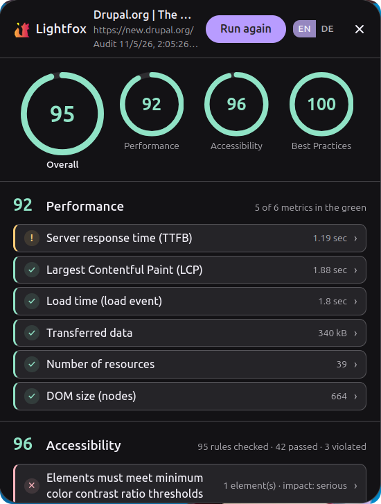
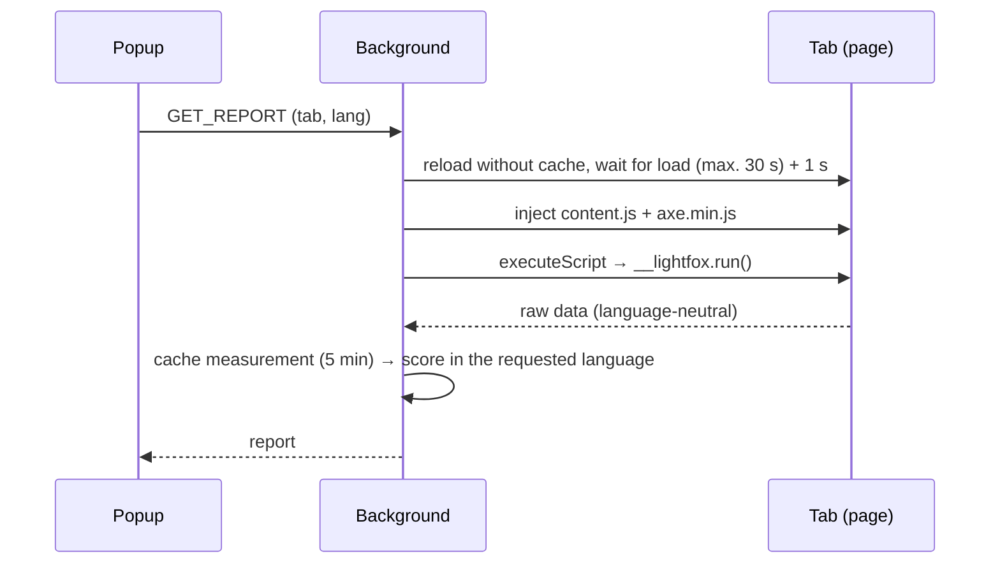
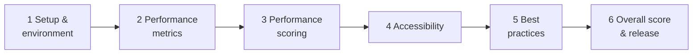

<p align="center">
  
</p>

<h1 align="center">Lightfox</h1>

<p align="center">
  <b>Lighthouse-style audits, native to Firefox.</b><br>
  Performance · Accessibility · Best Practices
</p>

<p align="center">
  
  
  
  
  <a href="LICENSE"></a>
</p>

<p align="center"><b>English</b> · <a href="README.de.md">Deutsch</a></p>

<p align="center">
  
  <br><sub>Audit of the official <a href="https://new.drupal.org/drupal-cms">Drupal CMS</a> page</sub>
</p>

Click the toolbar button and Lightfox **reloads the page without cache**, measures that fresh
load in your real Firefox, and shows a score (0–100) per category plus expandable findings,
similar to [Google Lighthouse](https://developer.chrome.com/docs/lighthouse/overview), which
[does not run in Firefox](https://github.com/GoogleChrome/lighthouse#lighthouse).
UI in **English and German** (EN/DE switch in the popup, choice is remembered).

> **Early alpha:** the core flow works; edge-case handling is deliberately minimal. Expect
> bugs and rough edges, and expect things to change. See [TODO](#todo).

## Quick start

```bash
npm install
npm run build      # → dist/
npm start          # build + start Firefox with the extension (web-ext)
```

Or load it manually: `about:debugging` → **This Firefox** → **Load Temporary Add-on** →
`dist/manifest.json`. After every build click **Reload** there.

| Command | Description |
| --- | --- |
| `npm run dev` | Build in watch mode |
| `npm test` | Build + content-pipeline test + end-to-end simulation (jsdom) |
| `npm run check` | Typecheck + tests + `web-ext lint` |
| `npm run icons` | Regenerate PNG icons from `public/icons/icon.svg` |

## How it works



1. **Measure:** the content script collects raw data only: LCP via
   [web-vitals](https://github.com/GoogleChrome/web-vitals), Navigation/Resource Timing,
   [axe-core](https://github.com/dequelabs/axe-core) results and 10 DOM checks. It is
   injected only for an analysis, never on normal page visits.
2. **Score:** the background turns the raw data into audits, category scores and texts.
   Switching the language re-scores the cached measurement, with no second reload.
3. **Show:** the popup renders score rings and expandable audits; JSON export included.

```text
src/
  background/   event page: reload, injection, cache · scoring.ts · audit-config.ts (thresholds, weights)
  content/      content script: perf.ts · axe-runner.ts · best-practices.ts
  popup/        popup UI: main.ts (requests, language, export) · render.ts (vanilla TS DOM)
  shared/       types.ts · i18n.ts (EN/DE texts) · format.ts (Intl)
public/         manifest.json · _locales/ · popup.html/css · icons/
scripts/        build.mjs (esbuild → 3 IIFE bundles + axe.min.js) · build-icons.mjs
tests/          content-smoke.mjs · e2e-sim.mjs (real dist/ bundles in jsdom)
```

Rule: `content/` and `popup/` import only from `shared/`.

### Audits & scoring

| Category | What is checked |
| --- | --- |
| **Performance** | TTFB (≤ 800 ms good / ≥ 1.8 s poor) · LCP (2.5 s / 4 s) · load time (3 s / 8 s) · transferred bytes (2 MB / 5 MB) · resources (50 / 120) · DOM nodes (1,500 / 4,000) |
| **Accessibility** | axe-core rules tagged WCAG 2.0–2.2 A/AA + `best-practice`; each violation with impact, elements, WCAG criteria and rule docs |
| **Best practices** | HTTPS · meta viewport · standards mode · mixed content · charset · obsolete HTML · `rel=noopener` · modern image formats · image aspect ratios · HTTP/2+ |

Metrics score linearly between *good* (1) and *poor* (0). axe violations weigh by impact
(critical 10 … minor 2) against passed rules (7 each). Overall = performance 40 % ·
accessibility 40 % · best practices 20 %; *n/a* audits and missing categories don't count.

## Lightfox vs. Google Lighthouse

| | Google Lighthouse | Lightfox |
| --- | --- | --- |
| Browser | Chrome / Chromium (DevTools Protocol) | Firefox (WebExtension, Manifest V3) |
| How to run | DevTools, PageSpeed Insights, CLI, Node API, CI | Toolbar button |
| Modes | Navigation, timespan, snapshot | Navigation (reload without cache) |
| Conditions | Simulated throttling (mobile CPU, slow 4G) by default | Your real Firefox, CPU and network (no throttling) |
| Categories | Performance, Accessibility, Best Practices, SEO | Performance, Accessibility, Best Practices |
| Performance metrics | FCP, LCP, TBT, CLS, Speed Index | TTFB, LCP, load time, bytes, resource count, DOM size |
| Performance scoring | Log-normal curves based on real-world data | Linear between *good* and *poor* |
| Accessibility engine | axe-core | axe-core |
| Report | HTML, JSON, CSV | Popup, JSON export |
| Languages | Many | English, German |
| Status | Stable | Early alpha |

## Contributing

Lightfox is an **early alpha**: everything is still in flux. Contributions and ideas are very
welcome: bug reports, feature ideas, pull requests, wording and translation improvements (EN/DE),
measurements from your own pages. Open an issue or pull request.

## TODO

- [ ] **Re-add CLS:** removed for the alpha: Firefox does not implement the
  [Layout Instability API](https://developer.mozilla.org/docs/Web/API/LayoutShift), so it was
  always *n/a*. Re-add once supported, or find an approximation.
- [ ] **Re-add INP:** removed for the alpha: it needs a user interaction, which never happens
  right after the reload. Options: keep measuring until the popup is reopened, or
  [Total Blocking Time](https://web.dev/articles/tbt) as a lab proxy.

Re-adding touches `PerfPayload` (`src/shared/types.ts`), `src/content/perf.ts`
(`onCLS`/`onINP`), `src/background/audit-config.ts` and `src/shared/i18n.ts`.

## Roadmap

Next goal: review and adjust every measurement step by step (detailed plan in the tutorial
notes, `20 Etappenplan Messlogik.md`).



| | Stage | Focus |
| --- | --- | --- |
| 1 | Setup & measurement environment | Baseline reports, test pages; reload, settle time, injection timing |
| 2 | Performance metrics | TTFB & load time · LCP · bytes, resources, DOM size · **CLS & INP (TODO)** |
| 3 | Performance scoring | Linear vs. log-normal curve, weights, minimum coverage, FCP |
| 4 | Accessibility | axe-core rule selection, iframes; impact weights & score |
| 5 | Best practices | Security (HTTPS, mixed content, noopener) · document checks · images & protocol |
| 6 | Overall score & release | Category weights, colors; docs, version `0.2.0` |

Stage 1 first; 2, 4 and 5 are independent; scoring follows its measurements. One stage
section = one commit with a [CHANGELOG](CHANGELOG.md) entry.

## Sources

- **WebExtensions (MDN):** [tabs.reload](https://developer.mozilla.org/docs/Mozilla/Add-ons/WebExtensions/API/tabs/reload) ·
  [scripting.executeScript](https://developer.mozilla.org/docs/Mozilla/Add-ons/WebExtensions/API/scripting/executeScript) ·
  [Event pages](https://developer.mozilla.org/docs/Mozilla/Add-ons/WebExtensions/Background_scripts#event_pages) ·
  [Internationalization](https://developer.mozilla.org/docs/Mozilla/Add-ons/WebExtensions/Internationalization)
- **Performance:** [Core Web Vitals](https://web.dev/articles/vitals) ·
  [LCP](https://web.dev/articles/lcp) · [TTFB](https://web.dev/articles/ttfb) ·
  [DOM size](https://web.dev/articles/dom-size) ·
  [Navigation Timing](https://developer.mozilla.org/docs/Web/API/PerformanceNavigationTiming) ·
  [Resource Timing](https://developer.mozilla.org/docs/Web/API/PerformanceResourceTiming) ·
  [web-vitals](https://github.com/GoogleChrome/web-vitals)
- **Accessibility:** [axe-core API](https://github.com/dequelabs/axe-core/blob/develop/doc/API.md) ·
  [rule descriptions](https://github.com/dequelabs/axe-core/blob/develop/doc/rule-descriptions.md) ·
  [WCAG 2.2](https://www.w3.org/TR/WCAG22/)
- **Best practices:** [Secure contexts](https://developer.mozilla.org/docs/Web/Security/Secure_Contexts) ·
  [Mixed content](https://developer.mozilla.org/docs/Web/Security/Mixed_content) ·
  [Viewport meta](https://developer.mozilla.org/docs/Web/HTML/Viewport_meta_tag) ·
  [Image formats](https://web.dev/articles/image-formats) ·
  [nextHopProtocol](https://developer.mozilla.org/docs/Web/API/PerformanceResourceTiming/nextHopProtocol)
- **Lighthouse (role model):** [scoring](https://developer.chrome.com/docs/lighthouse/performance/performance-scoring) ·
  [user flows](https://github.com/GoogleChrome/lighthouse/blob/main/docs/user-flows.md)
- **Design & tooling:** [Firefox design tokens](https://searchfox.org/mozilla-central/source/toolkit/themes/shared/design-system/dist/tokens-shared.css) ·
  [esbuild](https://esbuild.github.io/) · [web-ext](https://extensionworkshop.com/documentation/develop/getting-started-with-web-ext/)

Changes: [CHANGELOG.md](CHANGELOG.md) · License: [MIT](LICENSE)
